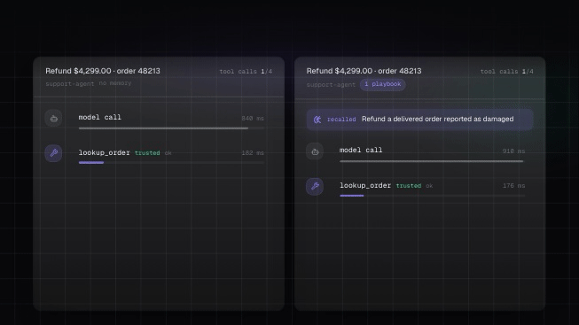
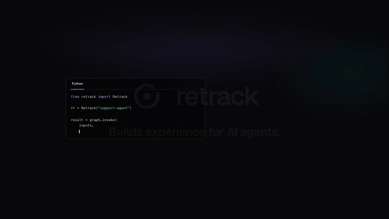

<div align="center">

<a href="https://retrack-ai.online">
  <picture>
    <source media="(prefers-color-scheme: dark)" srcset="assets/banner-dark.svg">
    
  </picture>
</a>

<br>

[](https://pypi.org/project/retrack-ai/)
[](https://pypi.org/project/retrack-ai/)
[](https://retrack-ai.online)
[](https://retrack-ai.online)

**[Website](https://retrack-ai.online)** &nbsp;·&nbsp; **[Benchmarks](https://retrack-ai.online/benchmarks)** &nbsp;·&nbsp; **[Docs](https://retrack-ai.online/docs)** &nbsp;·&nbsp; **[PyPI](https://pypi.org/project/retrack-ai/)**

</div>

<br>

## Your agent forgets everything between runs

It runs the same kinds of tasks every day and starts each one from scratch. It retries the same failing tool calls, trips over the same unwritten rules, and forgets what worked yesterday.

**Retrack gives production AI agents experience memory.** It watches every run, checks whether it worked, turns what worked into **playbooks** and what failed into **warnings**, and hands the right ones to your agent before its next similar task.

<div align="center">
  
</div>

<br>

## Measured, not promised

Real Claude agents, the same tasks from the same starting state, with and without memory.

<picture>
  <source media="(prefers-color-scheme: dark)" srcset="assets/stats-dark.svg">
  
</picture>

### Maple & Main: a real support agent

A Claude Haiku 5.5 support agent for an online store, built with LangGraph, with 11 tools and 5 to 10 steps per request. The store has rules the agent is never told (valid cancellation reasons, how gift-card orders are refunded, when a refund needs approval). It learns them only from its own errors.

<picture>
  <source media="(prefers-color-scheme: dark)" srcset="assets/mistakes-dark.svg">
  
</picture>

<picture>
  <source media="(prefers-color-scheme: dark)" srcset="assets/change-dark.svg">
  
</picture>

**The 13 requests that received memory made zero avoidable mistakes.** The 3 that remained came from requests that got no memory by design: Retrack's holdout group, and one request carrying an injected instruction, which the firewall quarantined and never learned from.

### Ops Desk: a second agent

An operations agent handling address changes, cancellations and refunds against APIs with unwritten rules (reason codes, PIN fields, approval limits, shipped orders).

<picture>
  <source media="(prefers-color-scheme: dark)" srcset="assets/ops-dark.svg">
  
</picture>

<details>
<summary><b>Full numbers as tables</b></summary>

<br>

**Maple & Main** (16 requests, memory from 8 earlier requests)

| | Without memory | With Retrack | Change |
|---|---:|---:|---:|
| Requests resolved correctly | 16/16 | 16/16 | |
| Avoidable mistakes | 15 | 3 | −80% |
| Steps per request | 7.19 | 6.25 | −13% |
| Tokens per request | 17,450 | 18,398 | +5% |
| Claude cost per request | $0.0344 | $0.0349 | +2% |
| Seconds per request | 8.6 | 8.1 | −6% |

**Ops Desk** (16 learning tasks, 20 evaluation tasks)

| | Without memory | With Retrack |
|---|---:|---:|
| Success rate | 95% | 100% |
| Tool calls per task | 2.90 | 2.40 |
| Tool errors per task | 0.75 | 0.25 |
| Tokens per task | 5,468 | 5,836 |

Tool errors fell 67% (95% interval: −0.75 to −0.25 errors per task). The +5 point success-rate change is not conclusive at this size (interval 0 to +15).

</details>

<details>
<summary><b>How the tests are run, and the honest limits</b></summary>

<br>

- **Same tasks, same starting state.** Each request runs with and without memory from the same seed, so the only difference is memory.
- **Hidden rules.** The agent is never told the rules it must learn; it discovers them from tool errors, as a production agent does.
- **Checked outcomes.** Success is the system's final state, not the agent's claim.
- **One model.** Claude Haiku 5.5 as the agent and for Retrack's own AI steps.

Limits:

- 16 paired requests show a clear effect, not a statistical proof.
- The support agent resolved every request even without memory. Memory removed mistakes and wasted steps; it did not turn failures into successes.
- Memory adds a playbook to the prompt. Fewer steps and retries pay for most of it, so cost is about flat. We do not claim token savings.
- Two simulated businesses and one model. Your agent will differ, which is why every project has a holdout group that measures the effect on your own traffic.

Full write-up: [retrack-ai.online/benchmarks](https://retrack-ai.online/benchmarks)

</details>

<br>

## How it works

<picture>
  <source media="(prefers-color-scheme: dark)" srcset="assets/pipeline-dark.svg">
  
</picture>

<div align="center">
  
</div>

<br>

| | |
|---|---|
| 📥 **Capture** | Every run: the task, each tool call and its result, the final answer, tokens and the model. Secrets are stripped on your machine before anything is sent. |
| ✅ **Verify** | The strongest signal available: a passing test, a resolved ticket, user feedback, or an AI judge. |
| 🧠 **Distil** | Verified successes become playbooks. Failures become warnings with the fix that worked. |
| 🎯 **Recall** | The right playbook reaches your agent before its next similar task, only when a confidence gate says it clearly matches. |
| 🛡️ **Firewall** | Runs fed by untrusted input never become memory without a check or your review. |
| 🧪 **Test** | Every playbook and known failure replays as a regression test in CI. |
| 🔁 **Migrate** | Replay memory on a new model before a forced model switch. |
| 📊 **Prove** | A holdout group gets no memory, so the effect is measured, not estimated. |

<br>

## Not another memory store

Mem0, Zep and Supermemory remember **what is true about users and documents**. Retrack remembers **what worked and what failed for your agent**.

<picture>
  <source media="(prefers-color-scheme: dark)" srcset="assets/compare-dark.svg">
  
</picture>

<br>

## Five-minute setup

<div align="center">
  
</div>

<br>

```bash
pip install retrack-ai
export RETRACK_API_KEY="rtk_live_..."   # from your project at retrack-ai.online
```

```python
import retrack

retrack.init(agent="support-agent")    # every run of your agent is now recorded

memory = retrack.recall(task)          # never raises; empty memory on any problem
result = graph.invoke({"messages": [("system", memory.as_prompt()), ("user", task)]})

retrack.feedback(outcome="success", source="test")   # tell Retrack what worked
```

> [!TIP]
> Using Claude Code, Cursor or Codex? In the dashboard, click **Copy setup prompt** and paste it into your coding assistant. It wires Retrack in for you.

**Never in your agent's way.** Capture runs in the background and never raises into your code. Recall gives up after 1.5 seconds and returns empty memory, so your agent always runs.

<br>

## About this repository

> [!NOTE]
> Retrack is a hosted, closed-source service. This repository is its public home on GitHub: the overview, results and a place for questions. **It contains no source code.** The Python connector, [`retrack-ai`](https://pypi.org/project/retrack-ai/), is published on PyPI under the MIT licence.

Retrack is in **free early access**. Sign in at [retrack-ai.online](https://retrack-ai.online) with GitHub. Questions, ideas or bugs: [open an issue](https://github.com/gokulakrishnanjawahar/retrack-ai/issues).

<br>

<div align="center">

**Retrack builds experience for AI agents.**

Built by [Gokul](https://github.com/gokulakrishnanjawahar) &nbsp;·&nbsp; [retrack-ai.online](https://retrack-ai.online)

<sub>Results as of November 2026. Product comparison reflects public documentation at that date.</sub>

</div>
